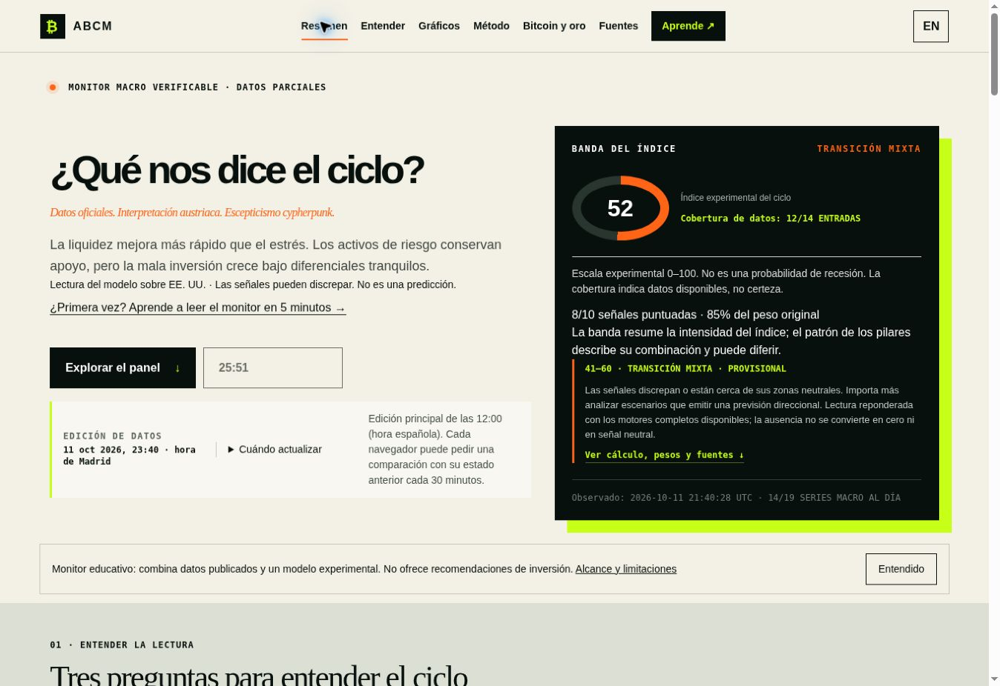
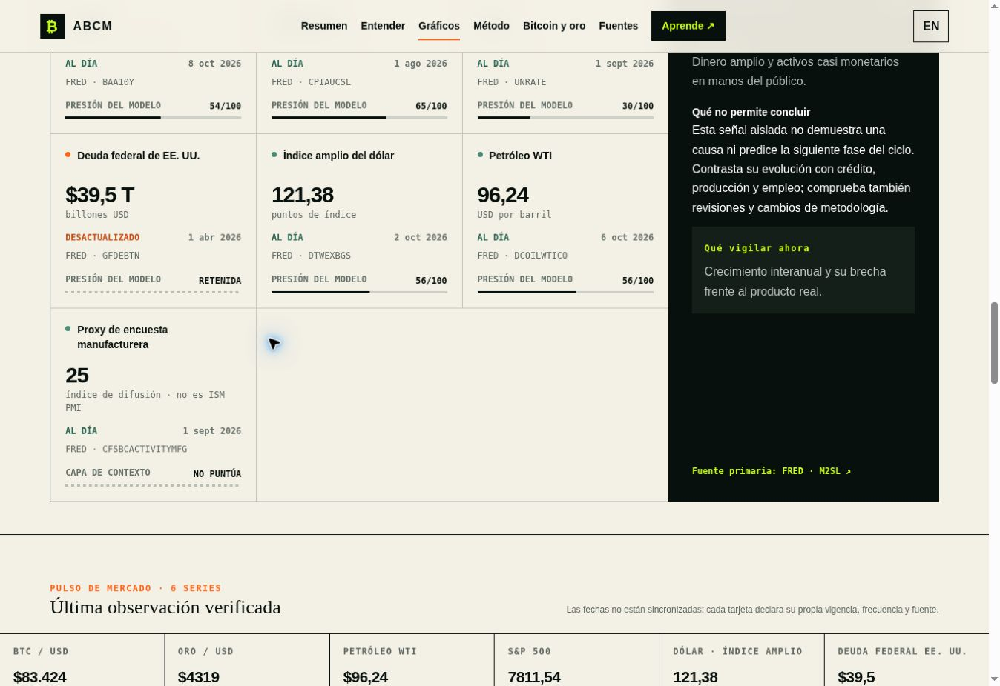

# Published v88 — production verification, 11 October 2026

[Public ABCM](https://austrian-business-cycle-monitor.jimblogic.chatgpt.site/)
was published after the owner's **“Test, fix, publish”** instruction. Master
and the v86 backups are preserved. PR #23 remains DRAFT, unmerged, without
auto-merge. Publication does not authorize merging the PR.

## Exact source and rollback

| Item | Verified reference |
| --- | --- |
| Sites saved version | 88 |
| Sites source commit | `3fd47705e9085bfaa9602d4929853e19dab65b6c` |
| GitHub release candidate commit | `7d5e6b01633efe4aff185e35c356ef90b70e734d` |
| Exact app tree on both providers | `bf6b091ffa5820086d19714490780a3186bd7470` |
| Deployment | `appgdep_6acbfbf3cf5c819186a37320c6a6e851`, succeeded 21:13:44 UTC |
| Saved version ID | `appgprj_6a630a89bf208191bc7915a9410ae47a~appgver_7b264872cd308191a69cc63253f4a6b6` |
| Local archive SHA256 | `3738d7fd0c83fbfacf156586b19952b27ceb77dda188d0d6d84eebf2128e170f` |
| Master kept unchanged | `59eb3b1266b75a0be8eea719cfb8ec564a5e5809` |
| Functional rollback | Saved Sites v86 and GitHub branch `backup/functional-sites-v86-20261009` |

The publication includes the v87 integrity changes, corrected monthly World
Bank gold metadata, Node 22 test compatibility and the maintained braces depth
backport. The original and patched dependency source hashes, limitations,
license, audit and test logs are in `sites-current/docs/release-20261011/` and
`sites-current/vendor/braces-bounded/`. No model formula or weight changed.

## Actual production checks

- `/api/health`: release 88, HTTP 200, DB ready, durable snapshot readable;
  20/20 observations, 15 fresh, honest overall DEGRADED.
- All requested indicators have finite real values, observation dates and the
  required source/status/attempt/success/value/freshness/failure/fallback fields.
- Index 52, provisional 12/14 inputs and 8/10 scored signals, 85% original
  weight. Missing fiscal scores are null; retained old values are marked stale.
- Opened the public URL after deployment. Clicked through the M2, Treasury
  2Y/10Y, debt, CPI, WTI, gold, S&P 500, VIX, industrial-production and Bitcoin
  charts; each showed dated observations and rendered data. Baa, Fed Funds and
  dollar were present in the signal board. ES/EN switching preserved data.
- Manual UI refresh generated `2026-10-11T21:40:28.667Z`, displayed at 23:40
  Madrid. The existing dashboard remained populated during the request.
- Independent API reads, a page reload and a second POST all returned that
  same edition. The second POST was `manual-cooldown`; browser reload restored
  the local 30-minute cooldown and comparison state. No reappearance of an
  empty dashboard was observed through this cycle.
- No site-origin warning/error appeared in the browser's captured logs.
  Browser-extension metadata errors were excluded and are not application
  errors. A separate network-request trace is not exposed by this browser API.

`health.json` contains the individual source audit; `data-summary.json` retains
values, dates, histories' observation counts, model evidence and the original
payload hash. `verification.json` records the checked invariants. This is an
observed deployment/refresh/reload cycle, not a promise of future uptime.

## Quality checks

Production build, lint, standalone typecheck, Worker artifact integrity and
164 application/security/source/fallback/snapshot/refresh tests pass. The
temporary backport also passes 764 unchanged released braces tests. Full
dependency audit is zero findings; local fork safety is supported by the
explicit tests/hashes rather than inferred from the registry audit.

[CI run 38175434476](https://github.com/JimBLogic/AustrianBusinessCycleMonitor/actions/runs/38175434476)
passes both exact Sites/self-host Node 22/Compose/Docker smoke and the complete
dependency-audit job on the exact published app tree. Further root scheduling
changes below have their own five passing tests and trigger the same CI again.

## Daily scheduler defect found and repaired in the candidate

The master workflow's `hour != 12 → exit 0` guard silently discarded delayed
GitHub scheduled runs. The 11 October run
[38154255744](https://github.com/JimBLogic/AustrianBusinessCycleMonitor/actions/runs/38154255744)
started at 16:09:19 UTC (18:09 Madrid). Job 114513844795 logged that guard,
performed no verification/refresh and immediately completed green. Earlier
scheduled runs also started late. A green scheduled-job status therefore did
not prove a daily edition was generated.

The candidate now uses `automation/production-daily.mjs`: before Madrid noon
it explicitly records the skipped slot; at or after noon it reads the actual
edition. An absent/corrupt/previous-day/pre-noon/future timestamp requests a
refresh, while an existing current edition is verified without duplicating
provider fetches. Summer/winter slots and a delayed run are covered by five
tests. A real scheduled-mode execution at 21:46 UTC selected `verify` and
validated v88's durable edition. No extra provider refresh was forced.

**This workflow correction is only on the candidate.** GitHub schedules execute
master, which remains unchanged under the owner's no-merge constraint. It
cannot yet repair master's unattended daily run. GitHub cron also offers no
guarantee of exact start time; the patch recovers delayed executions, not
punctuality. No additional automation or production schedule was created.

## Recommendation and remaining acceptance controls

**GO for the v88 data-reliability publication already completed and verified.**
**NO-GO for claiming every acceptance criterion complete or merging master
yet.** Actual mobile viewport QA remains unavailable in this browser, and the
daily scheduler correction still needs review/integration and a subsequent
real unattended execution. Desktop/browser/API tests are not substituted for
mobile QA. The temporary dependency fork must be maintained until retired in
favor of a verified official patch. No auto-merge has been enabled.
