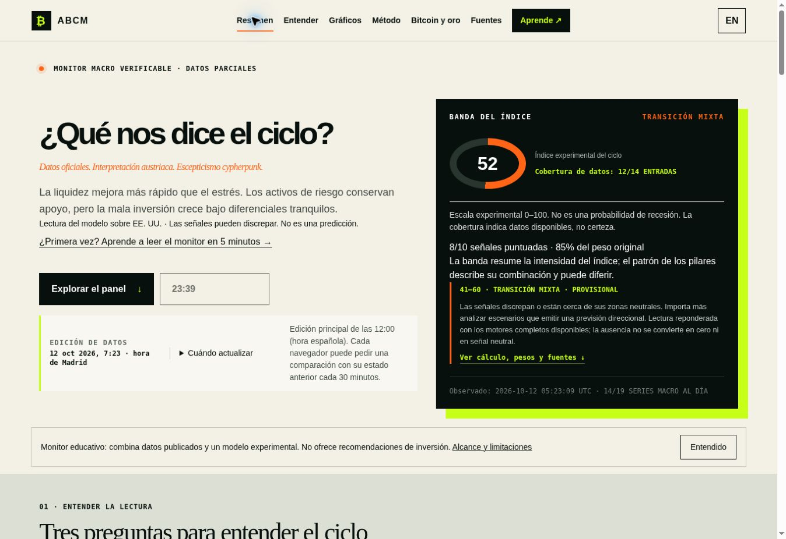

# v89 published and verified — 12 October 2026

[Public ABCM](https://austrian-business-cycle-monitor.jimblogic.chatgpt.site/?lang=es#top)

The intensive review repaired reproduced normalization and durable recovery
defects, separated self-host runtime readiness from data availability, and
strengthened the release/persistence/refresh verification gate. No formulas,
weights, artificial observations or aesthetic redesign were introduced.

## Publication and backups

- Sites v89: source `94c74d5d8a61338c1096f725271aba4d58414a23`.
- GitHub release commit: `ce1edfd051f4a2e32b8269efee81de1b37f34484`.
- Identical app tree on both providers: `418dda6ea167c518898c2638e76e1dc989b1d056`.
- Deployment `appgdep_6acc6e6b8cbc8191886ee92f76736fc7`: succeeded at 05:22:06 UTC.
- Local archive SHA256: `0dfbbb90b34a6c61c5afae46fc9eb288f99a813884117f7768513d968b82ae1e`.
- Hosted Drizzle migration files, public audience and environment revision 0 are unchanged.
- Saved Sites v86 and v88 remain available. GitHub v86 backup and
  `backup/functional-sites-v88-20261012` are preserved.
- Master remains `59eb3b1266b75a0be8eea719cfb8ec564a5e5809`; PR #23 is DRAFT, unmerged, without auto-merge.

## Actual production evidence

- Prior v88 durable edition from 11 October 21:40 UTC remained populated the
  following morning: 20/20 observations, readable D1. Stale BTC was labeled.
- Opened and reloaded the public URL after v89 deployment; the footer identified v89.
- Manual UI refresh generated `2026-10-12T05:23:09.378Z` (07:23 Madrid).
  Values remained visible during the request. API readback, browser reload and
  the second POST returned that same durable edition; the POST was manual-cooldown.
- 20/20 real observations, 15 fresh at check; honest DEGRADED state. Index 52
  remains provisional: 12/14 inputs, 8/10 scored signals, 85% weight. Missing
  fiscal scores remain null; stale production/debt observations retain dates.
- Twelve actual charts showed values, observation counts and dates in English.
  Switching back to Spanish retained the selected Bitcoin chart and values.
- All twelve listed public page/API HTTP smoke requests returned 200 and
  verified security headers. No site-origin warning/error appeared in captured
  logs; browser-extension metadata errors were excluded.

`health.json` retains every indicator's source, status, attempts, last success,
value, observation date, freshness, reason and fallback. `data-summary.json`
retains actual observations/model evidence and the full original payload hash.
No browser cookies, credentials, raw response headers or visitor data are saved.

## Quality and acceptance

Production build, lint, standalone typecheck, integrity and 184 tests PASS.
The unmodified upstream braces suite passes 764 tests.
[Exact candidate CI](https://github.com/JimBLogic/AustrianBusinessCycleMonitor/actions/runs/38207312229)
passes standalone Wrangler smoke, exact Docker/self-host and full dependency
audit (0 findings, including build tools). The local CLI namespace limitation
was not hidden; CI demonstrated the runtime smoke successfully. The temporary
backport still requires maintenance; registry audit alone is not its proof.

[Historical stack CI](https://github.com/JimBLogic/AustrianBusinessCycleMonitor/actions/runs/38207312192)
passes backend, frontend typecheck/tests/build and Docker. Its preexisting
Ruff/Black and ESLint reports still fail; the historical dependency backlog
is separate from Sites. Historical source/lockfiles are unchanged and are not
shipped in the maintained Worker artifact.

**GO for the v89 publication now verified. NO-GO for declaring all acceptance
criteria complete or merging master yet:** actual mobile QA is unavailable,
the corrected GitHub daily workflow is still candidate-only, and historical
quality/security reports need disposition. Neither a green global CI badge
nor this observed refresh/reload cycle is a guarantee of future uptime.
